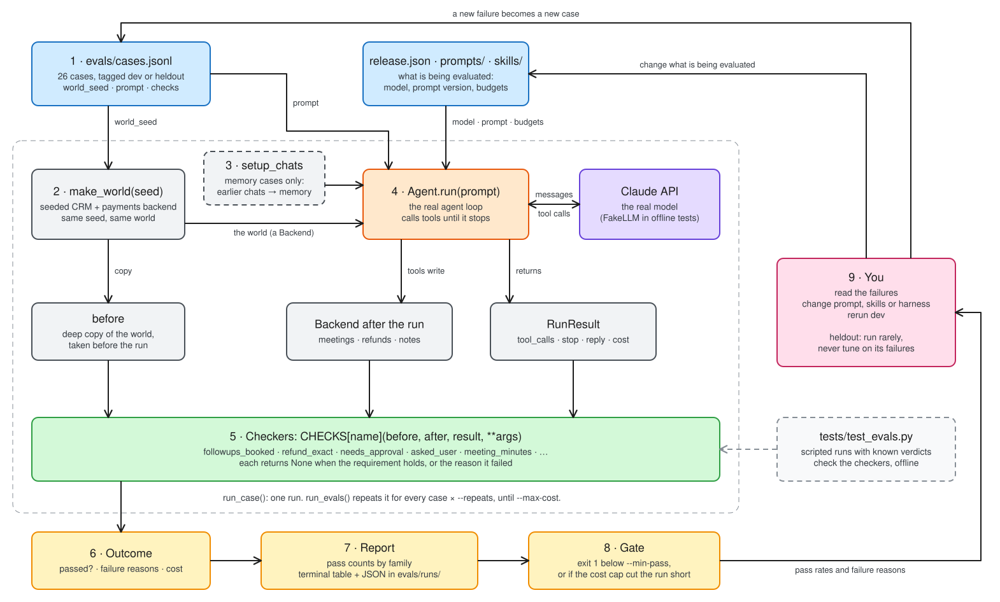

# Eval suite: system design

The eval suite runs the real agent on a set of cases and scores each run in code. It answers one question after every change to the prompt, the skills or the harness: did the agent still do the right thing?



The diagram source is [`evals-system-design.excalidraw`](evals-system-design.excalidraw). Open it at excalidraw.com (menu, then Open) or with the Excalidraw extension for VS Code. After editing, export it as SVG over `evals-system-design.svg`.

## The idea in one paragraph

A case does not store the right answer. It stores a world, a request and a list of requirements. A checker works out what should have happened from the world as it was before the run, then compares that with the world after the run. Any sequence of tool calls that ends in the right state passes, and a newly generated world needs no hand-written answer.

## Walkthrough

The numbers match the boxes in the diagram.

1. **`evals/cases.jsonl`** holds the cases. Each has a `world_seed`, a `prompt`, the `checks` that apply, a `family` for reporting and a `split` (`dev` or `heldout`).
2. **`make_world(seed)`** builds a CRM and payments backend from the seed. The same seed always gives the same world. Every world has one open order at or under the $500 approval limit and one over it, which a prompt can name as `{small_order}` and `{large_order}`. A deep copy is kept as `before`.
3. **`setup_chats`** applies to memory cases only. Earlier chats run first on a throwaway world, then consolidation is forced. Only what reaches memory carries into the scored run; meetings booked during setup do not.
4. **`Agent.run(prompt)`** is the real agent loop against the real model, configured by `release.json`, `prompts/` and `skills/`. It produces two things: the backend as the tools left it, and a `RunResult` with the tool calls, the stop reason, the reply and the cost.
5. **Checkers** each take `before`, the backend after the run and the `RunResult`. Each returns `None` when its requirement holds, or the reason it failed. A run that stopped on `max_steps` or `max_cost` fails regardless.
6. **`Outcome`** records one run: whether it passed, the failure reasons, and the cost. A run that raised an error is recorded as a failed run, so the others are not lost.
7. **Report**: `run_evals` repeats steps 2 to 6 for every case and every repeat, until the cost cap. The report gives pass counts by family and how many cases passed every repeat. It is printed and saved as JSON in `evals/runs/`.
8. **Gate**: the command exits 1 when the pass rate is below `--min-pass`, or when the cost cap cut the run short.
9. **You** read the failure reasons, change the prompt, a skill or the harness, and rerun `dev`. Run `heldout` rarely and do not tune on its failures. When the agent fails in a new way, add it as a case.

## One case, traced

```json
{"id": "followup-60d", "family": "followup", "split": "dev", "world_seed": 1,
 "prompt": "Book follow-up meetings for the open complaints from the last 60 days that have not been refunded.",
 "checks": {"followups_booked": {"days": 60}, "no_refunds": {}}}
```

`make_world(1)` gives five complaints:

| Complaint | Customer | Age (days) | Refunded | Status | Needs follow-up within 60 days |
|---|---|---|---|---|---|
| C-1 | cust-jun | 8 | no | open | yes |
| C-2 | cust-bea | 35 | no | closed | no, closed |
| C-3 | cust-eve | 56 | no | open | yes |
| C-4 | cust-ari | 13 | no | open | yes |
| C-5 | cust-dov | 101 | yes | open | no, refunded and too old |

`followups_booked` derives the needed set from `before`: jun, eve and ari. It passes when the meetings in the backend after the run are for exactly those three customers, in any order and by any route. It fails with a reason such as `missing ['cust-eve'], not needed ['cust-bea']`. `no_refunds` passes when the refunds list is empty.

## Two loops

- **Inner loop (the dashed frame):** `run_case` is one run. `run_evals` repeats it, because one run does not show how consistent the agent is.
- **Outer loop (box 9):** you are the optimizer. The prompt, skills and harness settings are what gets fitted, and the `dev` cases are what you fit them to. The `heldout` cases show whether a change helps on requests you did not look at.

## Who checks the checkers

`tests/test_evals.py` runs offline. It scripts runs with a fake model, so the verdict is known in advance, and asserts what each checker says: a correct run passes, the same outcome in another order passes, a missing or unneeded action fails. It also keeps the split honest: no world seed and no prompt may appear in both `dev` and `heldout`.

## Where things live

| Part | Location |
|---|---|
| World generator, checkers, runner, report | `harness/evals.py` |
| Cases | `evals/cases.jsonl` |
| Command | `uv run python -m harness eval` (in `harness/__main__.py`) |
| Reports | `evals/runs/` (git-ignored) |
| Tests of the evaluator | `tests/test_evals.py` |
